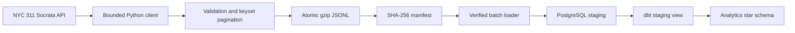
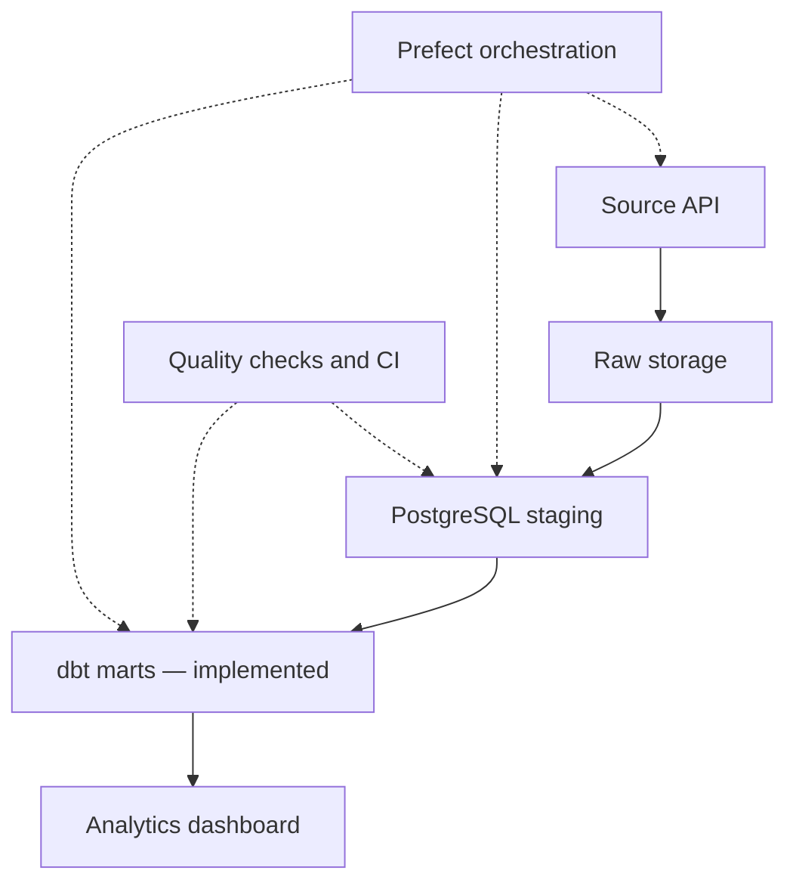

# DataForge 360 architecture

## Current scope: Phases 1–3 (dbt CI and Windows acceptance passed)

The ingestion command accepts an inclusive start date, exclusive end date, a
maximum record count, and a page size. It retrieves selected operational fields
using stable `(created_date, unique_key)` ordering, and rejects malformed,
out-of-range, non-advancing or unexpectedly shaped records.

Each date window maps to one deterministic filename. A rerun replaces that
window's snapshot instead of appending duplicates. The manifest records source,
date window, record count, download timestamp, and a checksum of decompressed
JSONL bytes. Failed ingestion removes staging files and does not publish the
incomplete snapshot. These guarantees apply to a single output file and do not
represent warehouse upsert or a full transactional lakehouse.

Phase 2 adds `staging.service_requests` with `unique_key` as a primary key,
payload-hash-aware `ON CONFLICT` upserts, a verification pass over the raw
snapshot and local Docker Compose. It commits in bounded batches. A hosted
PostgreSQL integration test is included in GitHub Actions; its server-side
result was successful. The project owner independently loaded and counted 100
real records locally on Windows on 2026-10-24.

Phase 3 models live in `dbt/`. They never mutate the operational source table.
Staging normalization feeds `dim_agency`, `dim_borough`, `dim_complaint`,
`dim_date`, and `fct_service_requests`. The latest known service-request state
is the fact grain. Relationships, cardinality and derived-duration checks
execute with `dbt build`; an isolated PostgreSQL CI job uses synthetic inputs
and verifies expected values plus repeat runs. GitHub Actions run 40105551077
passed the dbt PostgreSQL integration job, including all data and repeated-build
checks. The project owner supplied a successful Windows dbt debug and build
log on 2026-10-24 (6 models and 32 data tests, PASS=38, WARN=0, ERROR=0)
and confirmed 100 records in `analytics_marts.fct_service_requests`.

### Current limitations

- This is a **bounded historical extract**, not a continuous sync.
- `created_date` filtering cannot capture updates to arbitrarily old records.
  Operational upserts require a later refresh strategy and change reconciliation.
- Prefect scheduling, Power BI reporting and a hosted app are not yet implemented.
- dbt tables currently rebuild in full after source updates; this intentionally
  prioritizes correctness for bounded data over full-scale incremental materialization.
- The dimension tables are **current-state** views of categories; they are not
  historical slowly changing dimensions, and no source-event history exists.
- The source publishes timestamps without timezone offsets. Raw values stay
  source-local; future date normalization must specify the timezone and DST policy.
- Reaching `max_records` does not establish that all records in the window were
  fetched. Increase the cap or partition the date range for a full backfill.

## Planned next architecture

Phases will be implemented and demonstrated individually. A pipeline passing
its unit tests is not proof of hosted production readiness.
