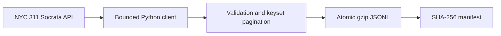
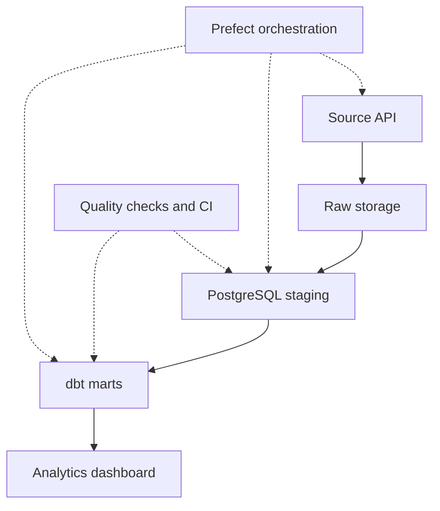

# DataForge 360 architecture

## Current scope: Phase 1 (implemented)

The ingestion command accepts an inclusive start date, exclusive end date, a
maximum record count, and a page size. It retrieves selected operational fields
using stable `(created_date, unique_key)` ordering, and rejects malformed,
out-of-range, non-advancing or unexpectedly shaped records.

Each date window maps to one deterministic filename. A rerun replaces that
window's snapshot instead of appending duplicates. The manifest records source,
date window, record count, download timestamp, and a checksum of decompressed
JSONL bytes. Failed ingestion removes staging files and does not publish the
incomplete snapshot. These guarantees apply to a single output file and do not
represent warehouse upsert or a full transactional lakehouse.

### Phase 1 limitations

- This is a **bounded historical extract**, not a continuous sync.
- `created_date` filtering cannot capture updates to arbitrarily old records.
  Operational upserts require a later refresh strategy and change reconciliation.
- No PostgreSQL warehouse, dbt models, Prefect schedule, Power BI report, or
  hosted app is implemented yet. Those belong to later milestones.
- The source publishes timestamps without timezone offsets. Raw values stay
  source-local; future date normalization must specify the timezone and DST policy.
- Reaching `max_records` does not establish that all records in the window were
  fetched. Increase the cap or partition the date range for a full backfill.

## Planned next architecture

Phases will be implemented and demonstrated individually. A pipeline passing
its unit tests is not proof of hosted production readiness.
