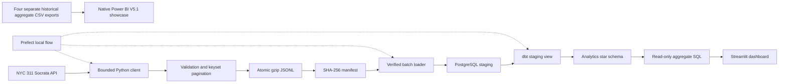
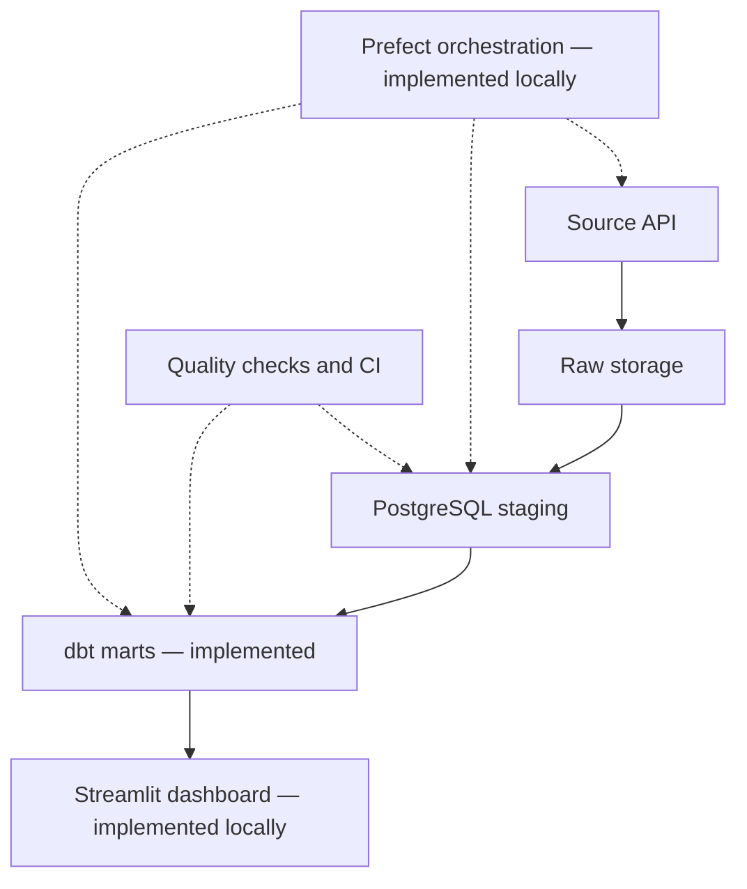

# DataForge 360 architecture

## Current scope: Phases 1–5 — locally demonstrated; hosting deferred

The ingestion command accepts an inclusive start date, exclusive end date, a
maximum record count, and a page size. It retrieves selected operational fields
using stable `(created_date, unique_key)` ordering, and rejects malformed,
out-of-range, non-advancing or unexpectedly shaped records.

Each date window maps to one deterministic filename. A rerun replaces that
window's snapshot instead of appending duplicates. The manifest records source,
date window, record count, download timestamp, and a checksum of decompressed
JSONL bytes. Failed ingestion removes staging files and does not publish the
incomplete snapshot. These guarantees apply to a single output file and do not
represent warehouse upsert or a full transactional lakehouse.

Phase 2 adds `staging.service_requests` with `unique_key` as a primary key,
payload-hash-aware `ON CONFLICT` upserts, a verification pass over the raw
snapshot and local Docker Compose. It commits in bounded batches. A hosted
PostgreSQL integration test is included in GitHub Actions; its server-side
result was successful. The project owner independently loaded and counted 100
real records locally on Windows on 2026-10-24.

Phase 3 models live in `dbt/`. They never mutate the operational source table.
Staging normalization feeds `dim_agency`, `dim_borough`, `dim_complaint`,
`dim_date`, and `fct_service_requests`. The latest known service-request state
is the fact grain. Relationships, cardinality and derived-duration checks
execute with `dbt build`; an isolated PostgreSQL CI job uses synthetic inputs
and verifies expected values plus repeat runs. GitHub Actions run 40105551077
passed the dbt PostgreSQL integration job, including all data and repeated-build
checks. The project owner supplied a successful Windows dbt debug and build
log on 2026-10-24 (6 models and 32 data tests, PASS=38, WARN=0, ERROR=0)
and confirmed 100 records in `analytics_marts.fct_service_requests`.

Phase 4 introduces the optional `dataforge.prefect_pipeline` flow, with task
retries, sequential ingestion/integrity/warehouse/dbt stages, atomic JSON run
evidence and an explicitly enabled local daily `flow.serve()` deployment.
Scheduled runs replay up to seven recent daily windows. They halt before the
warehouse when the per-day record cap is reached, since completeness cannot
be demonstrated for a capped window. CI separately exercises the actual
Prefect flow with synthetic records, replay safety and cap rejection.
The owner also completed a bounded Windows smoke run with 100 ingested rows,
zero updates on replay and 38 dbt checks passing. Continuous scheduling is
still an optional, unverified deployment mode.

Phase 5 adds a Streamlit dashboard that executes parameterized, date-bounded
aggregate SQL against dbt marts; processing remains in PostgreSQL. A **separate**
Windows-saved native Power BI V5.1 report displays four historical, pre-aggregated
CSV inputs for September 1–5, 2026, **not** a live feed from the dbt star schema.
Five Desktop pages, Queens within-page selection and CSV refresh loading are
documented from owner-supplied screenshots. The final PBIX is in Git; its 86
PBIR visual files and registered background/theme assets have since been
restored to the editable PBIP source and checked for static report-definition
parity against that PBIX. Independently reopening the reconstructed PBIP in
Windows Desktop and checking semantic-model equivalence remain **unverified**.
The isolated GitHub PostgreSQL/dbt/dashboard integration test passed, including
real Streamlit runtime execution over four synthetic warehouse records.

### Current limitations

- This is a **bounded historical extract**, not a continuous sync.
- `created_date` filtering cannot capture updates to arbitrarily old records.
  Operational upserts require a later refresh strategy and change reconciliation.
- Prefect scheduling **code** exists, but no real continuous hosted service,
  unattended Windows task or monitoring SLA is deployed yet.
- Power BI `.pbix` **is committed**, and the PBIP report JSON/assets now match its
  embedded report definition statically. The TMDL semantic model's functional
  Desktop reopen is not independently proven.
- The native PBIX uses four independent aggregate CSVs, so it is **not**
  integrated end-to-end with the PostgreSQL/dbt mart. Valid cross-table
  request-grain filtering requires a separate warehouse-connected BI model.
- Public hosting, load benchmarks and full unattended operational acceptance
  are deferred by the project owner.
- dbt tables currently rebuild in full after source updates; this intentionally
  prioritizes correctness for bounded data over full-scale incremental materialization.
- The dimension tables are **current-state** views of categories; they are not
  historical slowly changing dimensions, and no source-event history exists.
- The source publishes timestamps without timezone offsets. Raw values stay
  source-local; future date normalization must specify the timezone and DST policy.
- Reaching `max_records` does not establish that all records in the window were
  fetched. Increase the cap or partition the date range for a full backfill.

## Planned next architecture

Phases will be implemented and demonstrated individually. A pipeline passing
its unit tests is not proof of hosted production readiness.

## Acceptance boundary (2026-10-25)

Phases 1–5 have **bounded local/CI evidence**, not production certification.
See [local acceptance](LOCAL_RELEASE_ACCEPTANCE_2026-10-25.md) and
[Power BI native source verification](POWER_BI_NATIVE_REPORT.md). A static
PBIX↔PBIP report definition match does not establish a tested Windows PBIP
round-trip, embedded DataModel/TMDL equivalence or live warehouse-connected BI.
Deferred full end-to-end acceptance would also need late-status synchronization,
API completeness checks, unattended orchestration, repeatable scale benchmarks
and deployment monitoring; hosting is deliberately not started now.
